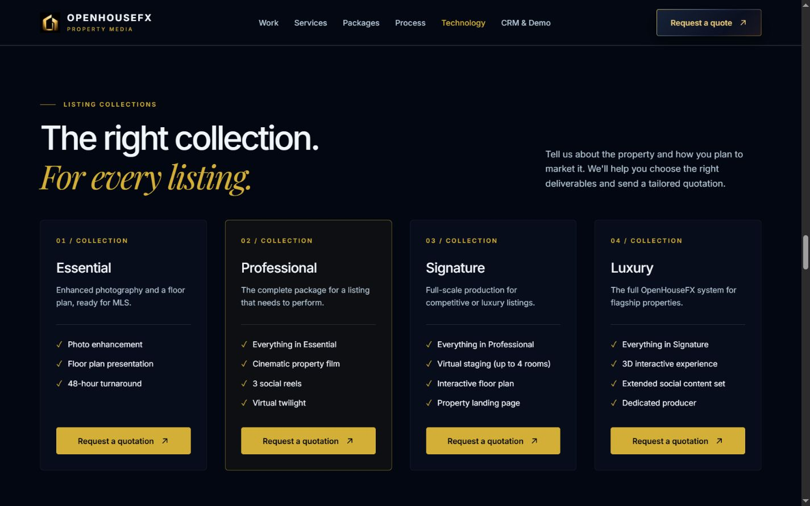
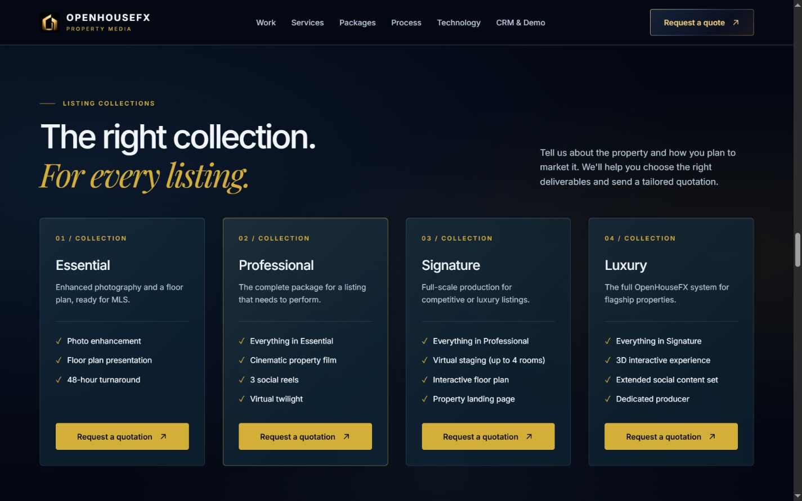

# OpenHouseFX Liquid Motion 4.0

Validated November 7, 2026. Base: `6bf59d2`. Branch: `feat/openhousefx-liquid-motion-v4`.

This release refines the existing homepage. Section order, business copy, property media, quotation behavior, contact details, product destinations, welcome choreography, and backend configuration are preserved. The branch is prepared for pull-request review; it has not been merged or deployed.

## Visual audit and implementation

- Hero and final CTA: separate navy/gold light fields, preserving the original media and content transforms. The film control reserves space for its changing label.
- Transformation: replaces the perpetual particle backdrop with visibility-gated ambient lighting. Comparison framing and selection states retain their existing behavior.
- Services, packages, process and team cards: existing glass utilities gain navy material depth, a fine inner reflection, warm focus/hover edges and restrained 3px lift. The featured collection remains distinct.
- Process/service markers and ecosystem icons: faint CSS light fields move behind recognizable, stationary symbols.
- Orbital ecosystem: a decorative background layer behind the existing geometry. Connector drawing, pulses, keyboard selection, screenshot galleries and destinations are unchanged.
- Footer: existing composition and approved content retained; contact-card focus and reflection styling refined, with no continuous lighting behind contact details.
- Navigation: fixes the six-link desktop menu overflowing at 768px by retaining the compact menu until 1024px. Destinations are unchanged.

## Motion architecture

`AmbientGradientLayer` shares one IntersectionObserver across eight selected surfaces. It also shares page-visibility, welcome-completion and font-readiness subscriptions. Decorative motion waits for the welcome and fonts, and pauses when its section is offscreen or the document is hidden.

The browser-only `ScrollLight` component is dynamically imported only when a visible, motion-enabled layer is eligible. Framer Motion owns its scroll-linked transform: velocity is clamped to ±26px, combined with ±8px of section progress, and damped with overdamped springs. Mobile uses 40% of this displacement. There are no per-scroll React state updates, wheel interception or scroll hijacking.

CSS owns the separate 19–25 second light drift, 8-second marker glow, card reflections, and 150–220ms button/card feedback. Existing Reveal and timeline controllers retain their own elements; neither GSAP nor CSS competes for the scroll layer's transform. The welcome component and hero playback implementation are unchanged. No new WebGL canvas or dependency is added.

Reduced motion retains static glass/gradients, removes the scroll component and disables decorative loops. Opaque material fallbacks remain available without backdrop-filter; mobile shared cards omit backdrop blur.

## Performance observations

These are **single-run local production-mode observations**, not field Core Web Vitals or a universal speed guarantee. The existing installed dependencies matched the lockfile and were reused. Builds used the repository's webpack configuration.

| Measurement | Before | Final |
| --- | ---: | ---: |
| Desktop LCP | 592ms | 524ms |
| Mobile LCP | 492ms | 692ms |
| Desktop CLS | 0.000080 | 0.000080 |
| Mobile CLS | 0.018230 | 0.018230 |
| Desktop long-task blocking in first 5 seconds | 430ms | 194ms |
| Mobile long-task blocking in first 5 seconds | 553ms | 9ms |
| Decoded JavaScript loaded during observation | 699,169 bytes | 715,383 bytes |

The lighting adds **16,214 decoded bytes, about 15.8KiB / 2.3%**, across loaded scripts. Its scroll helpers are deferred. An earlier compressed-initial-script estimate was contaminated by route prefetches and is excluded from this report.

Mobile LCP was 200ms higher in the final sample; other attempts varied substantially. That increase is disclosed rather than described as a speed improvement. Font-swap attribution explains the existing mobile CLS. A percentage inset in the initial decorative glow added to that shift; changing it to a fixed inset restored the baseline CLS.

Observed JavaScript heap snapshots were 6.33→13.12MiB on desktop and 5.42→7.08MiB on mobile. Garbage collection and navigation history were not controlled, so these are not comparable peak-memory measurements. GPU memory was not measured. Automated tab/background throttling made scroll-frame and interaction timing unsuitable for a reliable FPS or field-INP claim. More field/device profiling is needed to certify those metrics.

Raw load observations and responsive results: [measurements.json](liquid-motion/measurements.json). The measurement proxy and forced-preference harness live outside application source and are not deployed.

## Validation

| Check | Result |
| --- | --- |
| Production webpack build and TypeScript | Pass |
| Full ESLint, plus changed motion/navigation files after refinements | Pass |
| Existing Pocket Studio navigation tests | 2 passed |
| 320, 375, 390, 768, 1024, 1440, 1920px layouts | Pass; no horizontal overflow or clipped card text |
| Compact menu, link activation and menu closing | Pass; tablet overflow fixed |
| First welcome, natural completion, Skip Intro, session refresh | Pass; page access restored and eligible light starts afterward |
| Direct `/#technology` visit | Pass; no welcome interruption |
| Hero video and Play/Pause control | Pass |
| Service hover/focus material and video preview | Pass; 3px lift and gold edge; clip played to its 8-second end |
| Transformation selection | Pass; pressed state and preview update |
| Comparison keyboard control | Pass; right arrow changes 50→55 |
| Orbital keyboard selection and screenshot loading | Pass |
| Pocket Studio public/workspace links | Pass; exact existing destinations retained |
| All five telephone/email destinations | Pass; no messages or calls sent |
| Empty quotation form | Pass; three required-field errors |
| Empty quotation API request | Pass; HTTP 400, no email sent |
| Reduced-motion branch | Pass through local forced media/matchMedia harness; no scroll transforms, loops, welcome or hero autoplay |
| Tested normal-flow console/hydration checks | No warnings/errors observed |

Native OS preference emulation and Safari/Firefox were not exercised. The reduced-motion harness exercised the application and CSS branches locally; it is not an OS-level test. Provider email delivery was not tested. No production availability claim is made: the public reference URLs were inaccessible in this session, and verification used local production builds.

## Source files

Created:

- `components/motion/AmbientGradientLayer.tsx`
- `components/motion/ScrollLight.tsx`
- `components/motion/ambient.module.css`

Modified:

- `app/globals.css`
- `components/hero/CinematicHero.tsx`
- `components/ui/Button.tsx`
- `components/layout/Nav.tsx`
- `components/layout/footer.module.css`
- `components/sections/Transformation.tsx`
- `components/sections/Services.tsx`
- `components/sections/BeforeAfter.tsx`
- `components/sections/InteractiveExperience.tsx`
- `components/sections/Packages.tsx`
- `components/sections/HowItWorks.tsx`
- `components/sections/ForTeams.tsx`
- `components/sections/FinalCta.tsx`
- `components/ecosystem/EcosystemOrbitalWheel.tsx`
- `components/ecosystem/ProductSpotlight.tsx`
- `components/ecosystem/ecosystem.module.css`
- `components/ecosystem/orbital.module.css`

Documentation adds this report, the measurements JSON and four comparison screenshots under `docs/liquid-motion/`.

No backend routes, environment variables, CRM configuration, Supabase projects, Pocket Studio source, authentication, billing, deployment configuration, package manifest or lockfile were changed. Existing package text remains quotation-based; no numeric pricing was introduced.

## Visual comparison

Desktop before:

Desktop after:

Mobile before:

Mobile after:

No motion recording was produced; the screenshots document composition/material changes, while the scroll response was checked in the browser.

## Reference review

[ShaderGradient](https://github.com/ruucm/shadergradient) informed the soft ambient movement. [Liquid Glass JS](https://github.com/dashersw/liquid-glass-js) informed the optical edges and reflections. Their rendering implementations were not copied or installed. The existing [React Three Fiber](https://github.com/pmndrs/react-three-fiber) scenes retain their current loading and visibility gates.
